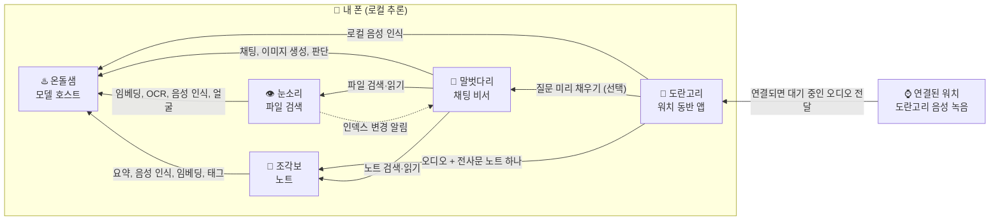

# 손안집 / Sonanjip

[English](README.md) | **한국어**

*손안의 집.* **S**earch, **O**rganize, **N**ote, **A**sk — **N**atively, **J**ointly, **I**n **P**rivate.

폰과 연결된 워치에서 AI를 쓰는 Android 앱 다섯 개입니다. 계정이나 클라우드 추론 없이 모델은 폰에서 돌고, 파일·노트·녹음은 내 기기에 머물며, 앱들은 한 지붕 아래에서 서로 돕습니다. 앱 이름은 모두 영어로도 부르기 쉬운 한국어입니다.

| 앱 | 하는 일 |
|---|---|
| [**온돌샘 / OndolSaem**](https://github.com/sonanjip/ondolsaem) | 모델 호스트. AI 모델을 한 번만 받아 메모리에 올려 두고 다른 앱과 함께 씁니다(임베딩, 채팅, 이미지 생성, OCR, 음성 인식, 얼굴, 예·아니오 판단, 지원 칩에서는 NPU). 집 전체를 데우는 *온돌*과 누구나 물을 긷는 *샘*. |
| [**눈소리 / Nunsori**](https://github.com/sonanjip/nunsori) | 폰 안의 사진·문서·음성·영상을 의미로 검색합니다. *눈*으로 보고 *소리*로 듣습니다. |
| [**조각보 / Jogakbo**](https://github.com/sonanjip/jogakbo) | 메모, 웹페이지, 유튜브, 녹음을 노트로 모으고, 폰에서 요약·태그·검색을 합니다. 자투리 천을 이어 만든 *조각보*처럼. |
| [**말벗다리 / Malbotdari**](https://github.com/sonanjip/malbotdari) | 내 파일(눈소리)과 노트(조각보)를 찾아 답하는 채팅 비서. 이야기 상대 *말벗*, 앱을 잇는 *다리*. |
| [**도란고리 / Dorangori**](https://github.com/sonanjip/dorangori) | 폰 + Wear OS 동반 앱. 워치에서 음성을 녹음해 연결될 때까지 대기열에 보관하고, 폰의 온돌샘으로 로컬 음성 인식을 합니다. 텍스트 복사, 말벗다리 질문 미리 채우기, 오디오와 전사문을 함께 담은 조각보 노트 하나로 저장하기를 지원합니다. 녹음을 넘어 폰·워치 온디바이스 AI로 확장할 수 있습니다. |

## 도란고리: 워치에서 폰으로

실제 에뮬레이터 UI에서 사전 녹음된 음성 샘플을 에뮬레이터 마이크에 공급한 데모입니다. 클라우드 추론 없이 로컬에서 처리합니다.

## 앱 사이의 관계

온돌샘은 다른 앱 없이도 설치할 수 있고, 나머지 앱들이 모두 기대는 바탕이라 먼저 설치합니다. 눈소리와 조각보는 온돌샘만 있으면 되고, 말벗다리는 온돌샘에 더해 설치된 눈소리와 조각보도 씁니다. 도란고리는 인식 언어를 명시하기 위해 온돌샘 **0.9.0 이상**이 필요하며, 오디오와 텍스트를 함께 저장하려면 조각보 **0.7.0 이상**이 필요합니다. 말벗다리는 선택 사항입니다.

## 이름의 뜻

이름은 일상적인 한국어에서 왔고 영어로도 부르기 쉽습니다. 일부에는 하는 일을 풀어 쓴 역두문자도 있으며, 도란고리는 한국어 자체의 뜻을 담았습니다.

- **손안집 (Sonanjip)**: **손** + **안** + **집**, *손안의 집*입니다. 앱들은 폰과 연결된 워치에 살고, 내 것은 내 기기에 머뭅니다. *온돌*과 *조각보*가 이미 한옥 살림에서 온 이름이라, 조직은 그 앱들이 함께 사는 집이 됩니다. 역두문자: **S**earch, **O**rganize, **N**ote, **A**sk(앱들이 하는 일) — **N**atively, **J**ointly, **I**n **P**rivate(하는 방식).
- **온돌샘 (OndolSaem)**: 집 전체를 밑에서 데우는 **온돌** + 누구나 물을 길어 가는 **샘**. 다른 앱들 아래에서 모델을 데워 두고, 모든 앱이 같은 샘에서 길어 갑니다. ONDOL + SAEM. [자세히](https://github.com/sonanjip/ondolsaem/blob/main/README.ko.md#이름의-뜻)
- **눈소리 (Nunsori)**: **눈** + **소리**. 눈으로 보는 것과 귀로 듣는 것을 함께 인덱싱합니다. NUNSORI. [자세히](https://github.com/sonanjip/nunsori/blob/main/README.ko.md#이름의-뜻)
- **조각보 (Jogakbo)**: **조각** + **보**. 자투리 천을 이어 만든 보자기처럼, 웹페이지·영상·녹음·메모 조각을 이어 노트로 모읍니다. JOGAKBO. [자세히](https://github.com/sonanjip/jogakbo/blob/main/README.ko.md#이름의-뜻)
- **말벗다리 (Malbotdari)**: 이야기 상대 **말벗** + 앱을 잇는 **다리**. 대화하는 비서이면서 다른 앱으로 건너가 답을 찾아옵니다. MALBOT + DARI. [자세히](https://github.com/sonanjip/malbotdari/blob/main/README.ko.md#이름의-뜻)
- **도란고리 (Dorangori)**: 조용하고 다정하게 이야기하는 **도란도란** + 연결과 둥근 형태를 뜻하는 **고리**. 청록색과 살구색 고리가 서로 얽힌 아이콘은 워치와 폰을 잇습니다.

**설치**: 온돌샘을 먼저 설치하고, 원하는 앱을 추가하세요. APK는 각 레포의 Releases에 있습니다(폰: Android 10 이상, arm64; 워치: Wear OS 3 이상). 앱들은 같은 키로 서명되어 직접 연결됩니다. 도란고리는 서명 인증서가 일치하는 폰용·Wear용 APK를 모두 설치하세요. 삼성 실물 기기는 기존 Galaxy Wearable 앱으로 페어링하며, Pixel Watch 앱은 에뮬레이터 설정용입니다. 워치의 Wi-Fi ADB 사이드로드 방법은 [도란고리 레포](https://github.com/sonanjip/dorangori)에 있습니다.
