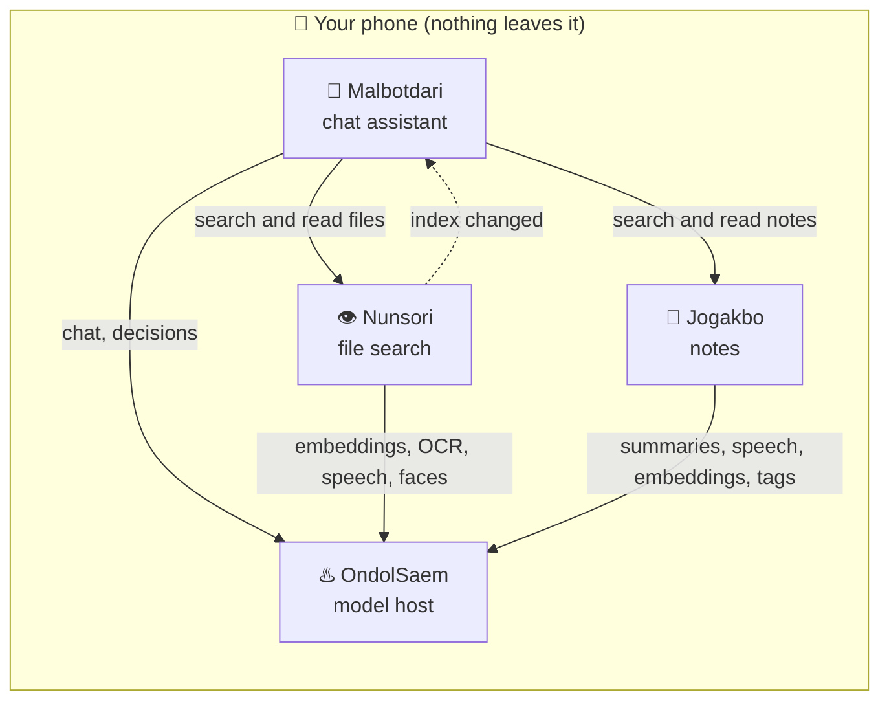

# Sonanjip / 손안집

**English** | [한국어](README.ko.md)

*A house in your hand.* **S**earch, **O**rganize, **N**ote, **A**sk — **N**atively, **J**ointly, **I**n **P**rivate.

Four Android apps that keep your AI on your phone. No account and no cloud: the models run on the device, your files and notes stay there, and the apps work together under one roof. Each app has a Korean name that is easy to say in English.

| App | What it does |
|---|---|
| [**OndolSaem / 온돌샘**](https://github.com/sonanjip/ondolsaem) | The model host. Downloads each AI model once, keeps it in memory and shares it with the other apps (embeddings, chat, OCR, speech, faces, yes/no decisions; NPU on supported chips). *Ondol* warms the whole house, a *saem* (spring) serves everyone. |
| [**Nunsori / 눈소리**](https://github.com/sonanjip/nunsori) | Search the photos, documents, audio and video on your phone by meaning. *Eye and sound*: it sees and hears your files. |
| [**Jogakbo / 조각보**](https://github.com/sonanjip/jogakbo) | Notes from memos, web pages, YouTube and recordings, each with an on-device summary, tags and search. A *jogakbo* is a patchwork wrapping cloth. |
| [**Malbotdari / 말벗다리**](https://github.com/sonanjip/malbotdari) | A chat assistant that answers from your files (through Nunsori) and notes (through Jogakbo). A *malbot* is someone to talk to, a *dari* a bridge. |

## How they fit together

OndolSaem needs none of the others and all of them build on it, so install it first. Nunsori and Jogakbo need only OndolSaem; Malbotdari uses OndolSaem plus Nunsori and Jogakbo when they are installed.

## About the names

Every name here is a compound of everyday Korean words that is easy to say in English, with a backronym that says what it does.

- **손안집 (Sonanjip)**: **손** (hand) + **안** (inside) + **집** (house), *a house in the palm of your hand*. The apps live in the phone you hold, and what is yours stays inside that house. *Ondol* and *jogakbo* already come from a Korean home, so the organization is the house they share. Backronym: **S**earch, **O**rganize, **N**ote, **A**sk (what the apps do) — **N**atively, **J**ointly, **I**n **P**rivate (how they do it).
- **온돌샘 (OndolSaem)**: **온돌**, the floor heating that warms a whole house from underneath, + **샘**, a spring everyone draws from. It sits below the other apps, keeps the models warm and lets every app draw from the same source. ONDOL + SAEM. [More](https://github.com/sonanjip/ondolsaem#about-the-name)
- **눈소리 (Nunsori)**: **눈** (eye) + **소리** (sound). It indexes what can be seen and what can be heard. NUNSORI. [More](https://github.com/sonanjip/nunsori#about-the-name)
- **조각보 (Jogakbo)**: **조각** (scrap) + **보** (wrapping cloth), a patchwork cloth sewn from scraps, as notes are stitched from web pages, videos, recordings and memos. JOGAKBO. [More](https://github.com/sonanjip/jogakbo#about-the-name)
- **말벗다리 (Malbotdari)**: **말벗** (someone to talk to) + **다리** (bridge). An assistant to talk with that bridges your other apps. MALBOT + DARI. [More](https://github.com/sonanjip/malbotdari#about-the-name)

**Install**: start with OndolSaem, then add the apps you want. APKs are on each repository's Releases page (Android 10+, arm64). The apps are signed with the same key, so they connect to each other directly.
